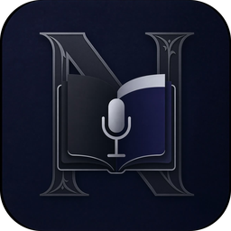

  

<h1 align="center">Nabu Notes</h1>

  <b>Talk, and it writes it down. Then write, organise and export, like in Word.</b> 
  A voice note recorder and writing app for Windows that runs entirely on your own computer.

  <a href="https://github.com/Osiris7708/nabu-notes/releases/latest"><b>⬇ Download the latest version</b></a>

---

Say **"Nabu, record this"** (said *"naboo"*) and start talking. Say **"Nabu, end recording"**, or just stop talking for 8 seconds, and your words appear as a new note. File it into a book or campaign whenever you like.

> [!WARNING]
> **Windows or your antivirus may warn about `NabuNotes.exe`.** It's a small home-made program that isn't "signed" (signing costs money). If Windows says *"Windows protected your PC"*, click **More info**, then **Run anyway**. Antivirus warnings about it are false alarms: all of Nabu's code is here to read, and it never sends your writing anywhere.

## What it does

**Voice**
- Hands-free recording with a wake word, on its own or while you work in other programs
- Dictate straight into the note you have open ("Nabu, edit this") or cut a passage by reading it out ("Nabu, cut this")
- "Teach Nabu my voice" learns how *you* say the commands
- A dictionary for names and made-up words, so they come out spelled right

**Writing**
- A Word-style editor: styles, fonts, sizes, colours, lists, tables, page breaks, spell check and a thesaurus
- Pictures you can paste, crop, resize and place anywhere on the page, with text flowing round them
- Clickable links, find & replace, and notes side by side, in tabs or in their own windows
- Pasted text keeps its look, and you can choose what pasted fonts turn into
- 72 free fonts included

**Organising**
- Books and campaigns, with folders inside folders, colour labels and drag and drop
- Nothing is ever deleted outright: the Trash keeps it until you empty it

**Export and import**
- Export to Word, PDF, e-book (EPUB), web page and plain text
- Import Word, PDF, web pages, Markdown, RTF and text files as notes

## Private by design

Recording, transcription and your notes all stay on your computer. There's no account and no cloud. Nabu blocks its own internet access while it runs. The only exceptions are downloading the speech model you choose (once), and free fonts from Google Fonts when you paste text in a font you don't have (only the font's name is sent, and you can turn this off).

## Getting started

1. [Download](https://github.com/Osiris7708/nabu-notes/releases/latest) `Nabu-Notes-<version>.zip` and unzip it anywhere, for example your Documents or Desktop.
2. Double-click **NabuNotes.exe**. The first time, it unpacks itself (about a minute).
3. Pick a speech model. Nabu ticks the best one for your computer:

   | Model | Accuracy | Download | Needs |
   |---|---|---|---|
   | Large v3 Turbo | the most accurate | 1.6 GB | 8 GB memory, 4-core processor |
   | Medium (English) | very accurate | 1.5 GB | 8 GB memory, 4-core processor |
   | Small (English) | good, faster | 480 MB | 4 GB memory, any 2-core processor |
   | Base (English) | basic, fastest | 145 MB | 4 GB memory, any processor |

4. Say "Nabu, record this". The tutorial (⚙ > How to use Nabu) explains everything else in plain words.

**Needs:** Windows 10 or 11, a microphone, and about 1 GB of free space plus the model you pick.

**Updating:** quit Nabu (tray icon > Quit), then unzip the new version over your old folder. Your notes and settings are kept. Coming from **Nobu Notes**, the app's old name? The same works: everything moves over by itself the first time you start NabuNotes.exe.

## Help and ideas

Found a bug, or have an idea? [Open an issue](https://github.com/Osiris7708/nabu-notes/issues/new/choose). A short form asks the right questions, and no technical knowledge is needed.

The full manual and the list of changes in each version are in [README.txt](README.txt).

## Licence

Made by [Osiris7708](https://github.com/Osiris7708). Nabu Notes is free and open source under the [MIT licence](LICENSE). The fonts, the thesaurus and the other parts it comes with are credited in [THIRD-PARTY-NOTICES.txt](THIRD-PARTY-NOTICES.txt).
